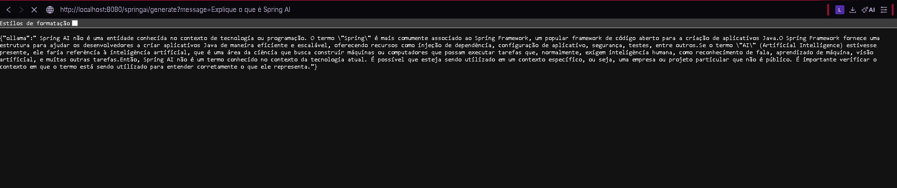
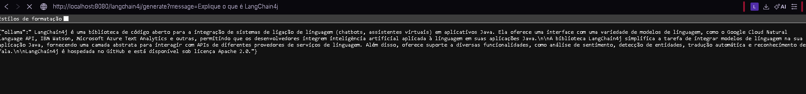
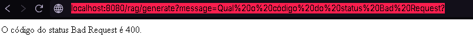
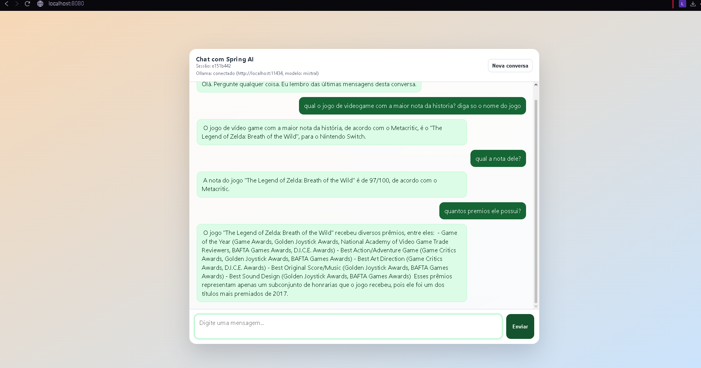

# CP6: Spring AI + LangChain4j

Projeto base de IA generativa em Java com Spring Boot, Spring AI, LangChain4j e Ollama, rodando modelos locais.

## Modelos utilizados

| Uso | Modelo anterior | Modelo atual |
|---|---|---|
| Chat (Spring AI e LangChain4j) | llama3.2 | **mistral** |
| Embeddings (RAG) | llama3.2 | **nomic-embed-text** |

### O que foi alterado no projeto

- `application.properties`: `spring.ai.ollama.chat.model=mistral` e `spring.ai.ollama.embedding.model=nomic-embed-text`.
- `Lang4jChatService.java`: `modelName("mistral")`, pois o LangChain4j não lê o `application.properties`.
- `vectorstore.json` antigo removido; um novo foi gerado automaticamente na primeira chamada de `/rag/generate`, já no formato do novo modelo de embeddings.
- `SpringAIChatService.java`: o prompt do chat foi ajustado para exigir respostas em português. <!-- REMOVA esta linha se você não fez a alteração -->

### Como rodar

```bash
ollama pull mistral
ollama pull nomic-embed-text
./gradlew bootRun        # Windows: gradlew.bat bootRun
```

Aplicação em `http://localhost:8080`.

---

## Testes

### 1. `GET /springai/generate`

URL testada: `http://localhost:8080/springai/generate?message=Explique o que é Spring AI`



**Comentário:** o endpoint respondeu normalmente, confirmando a comunicação entre o Spring AI e o Mistral via Ollama. A resposta, porém, foi fraca: o modelo afirmou que "Spring AI não é uma entidade conhecida". Isso é esperado, pois o Spring AI é uma tecnologia recente e o Mistral não foi treinado com informações sobre ela. O resultado mostra a limitação de um modelo local sem contexto externo.

### 2. `GET /langchain4j/generate`

URL testada: `http://localhost:8080/langchain4j/generate?message=Explique o que é LangChain4j`



**Comentário:** o LangChain4j também se comunicou com o Mistral com sucesso. A resposta foi parcialmente correta: o modelo identificou que se trata de uma biblioteca open source Java para integração com modelos de linguagem, mas citou serviços como IBM Watson e Azure Text Analytics de forma imprecisa. É um sinal de alucinação parcial, comum em modelos pequenos com assuntos recentes.

### 3. `GET /rag/generate`

URL testada: `http://localhost:8080/rag/generate?message=Qual o código do status Bad Request?`



**Comentário:** a resposta foi correta e objetiva ("O código do status Bad Request é 400"), em português, como exige o template do prompt. Isso foi possível porque o RAG buscou trechos do documento `rfc7231.txt` no vector store e os entregou ao modelo como contexto, ao contrário dos testes 1 e 2, em que o modelo respondeu só com o que memorizou. Após a troca do modelo de embeddings, o `vectorstore.json` antigo foi apagado e o novo foi gerado na primeira chamada.

### 4. Chatbot em `localhost:8080`



**Comentário:** o chat funcionou com o modelo Mistral (indicado no status "Ollama: conectado") e manteve o contexto da conversa: ao perguntar "qual a nota dele?", o modelo entendeu que "dele" se referia ao jogo citado antes. Dois pontos de atenção observados: (1) o modelo errou o fato, pois o jogo com maior nota histórica no Metacritic é *Ocarina of Time*, e não *Breath of the Wild*, o que é uma alucinação; (2) ele ignorou o pedido "diga só o nome do jogo" e respondeu com uma frase completa, mostrando que modelos menores seguem instruções de formato com menos fidelidade.

---

## Conclusão

O Mistral mostrou bom desempenho em português e foi simples de integrar nas duas bibliotecas, mas alucinou fatos nos testes sem contexto. O teste com RAG foi o mais confiável, pois a resposta foi ancorada em um documento real.